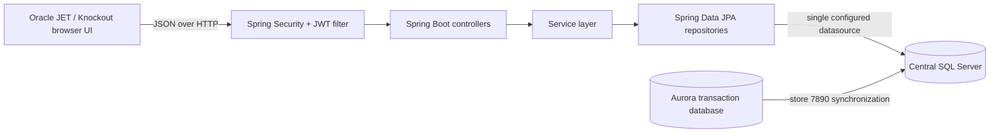
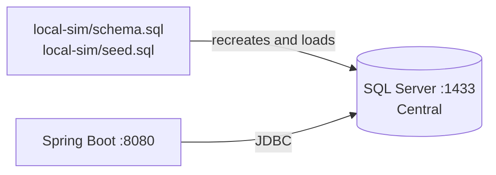
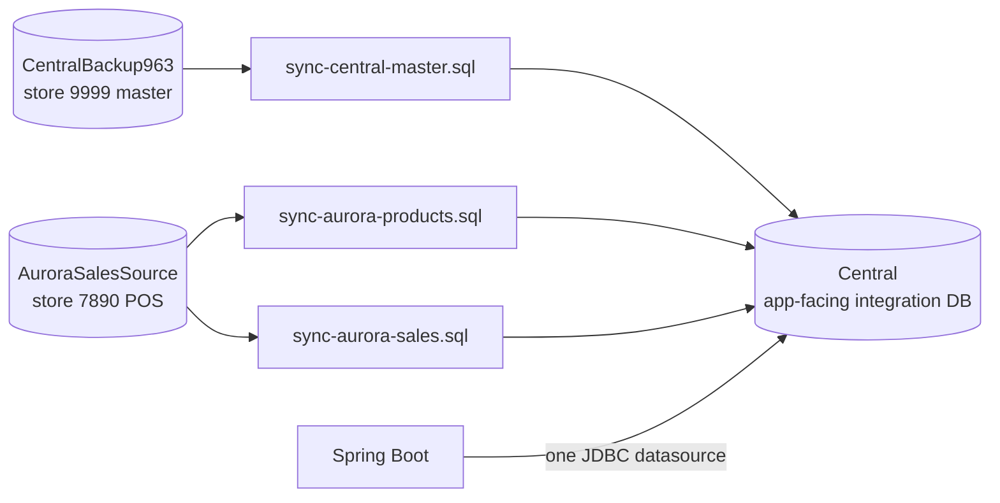
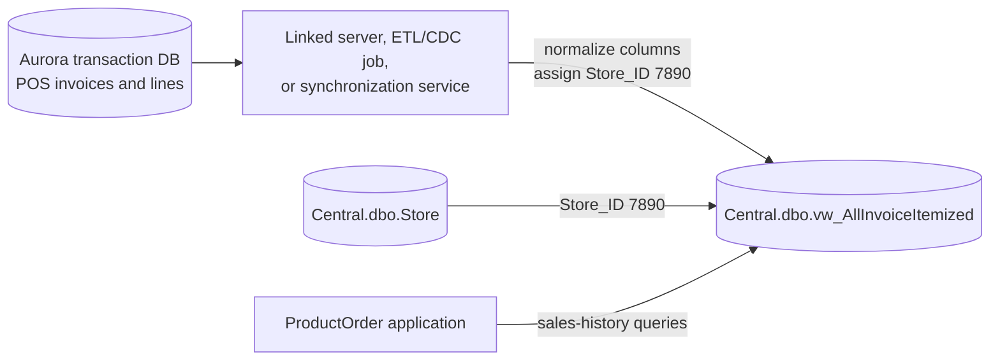
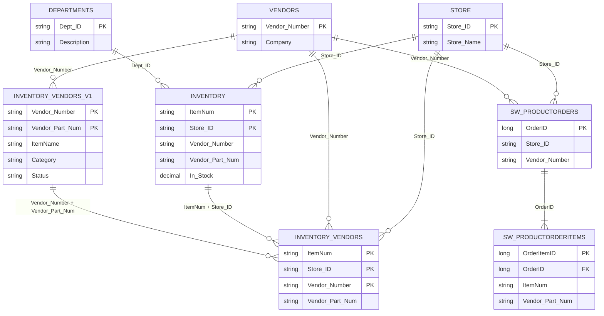
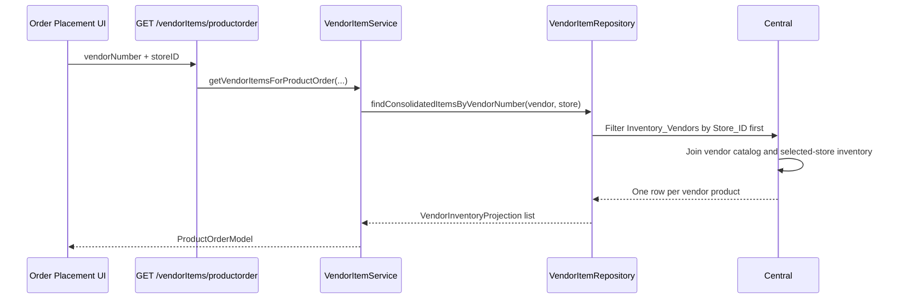
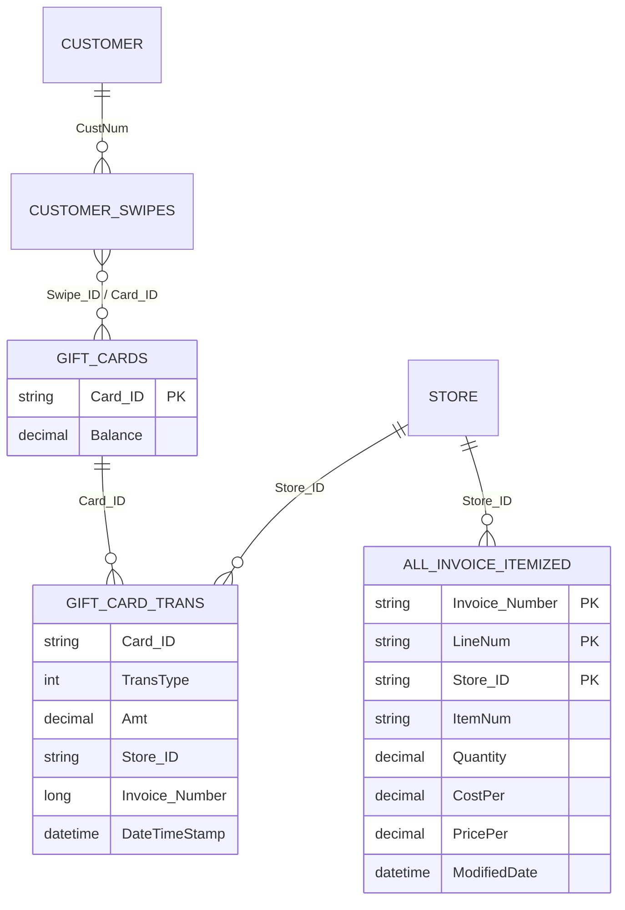

# ProductOrder Architecture

## Scope

This document maps the current ProductOrder application, its Central SQL Server database, the Aurora store transaction source, and the keys used to connect product and transaction records.

Aurora is the store represented by `Store_ID = 7890`. The restored local topology now uses two source databases: `CentralBackup963` for the Central store/master backup and `AuroraSalesSource` for Aurora transactions and store inventory. Both are normalized into the app-facing `Central` database so the application retains one datasource.

## System overview



The application currently has one datasource. All JPA entities and native queries execute against the `Central` catalog configured by `spring.datasource.*`.

## Runtime topology

### Local simulation



The base seed can still run without restored backups. With the supplied backups restored, `local-sim/sync-central-master.sql` imports the Central store `9999` master snapshot, `local-sim/sync-aurora-products.sql` imports Aurora store `7890`, and `local-sim/sync-aurora-sales.sql` imports Aurora receipt lines.

Because item-level sales are joined by `ItemNum + Store_ID`, the demonstration product IDs cannot be used with real Aurora invoice lines. The backup synchronization replaces only the corresponding store-scoped master snapshots and preserves application-owned users, orders, bills, and configuration.

### Completed backup linkage



The current linked snapshot contains 19,451 active Central products, 24,514 Central vendor mappings, 5,141 Central catalog rows, 19,598 active Aurora products, 8,440 Aurora vendor mappings, and 791,020 Aurora invoice lines. There are 2,288 exact `Vendor_Number + Vendor_Part_Num` links between Aurora mappings and the Central catalog.

### Intended production mapping



The preferred application boundary is Central: the application continues using one datasource, while Central exposes normalized transaction records through `vw_AllInvoiceItemized`. If cross-database access is unavailable, the alternative is a second Spring datasource and a dedicated Aurora transaction repository; that alternative is not currently implemented.

## Application layers

| Layer | Location | Responsibility |
|---|---|---|
| Browser UI | `src/main/resources/static` | Store/vendor selection, order placement, dashboards, gift cards, and administration |
| Security | `config/SecurityConfig.java`, `config/JwtFilter.java` | Public login/static assets and JWT protection for application APIs |
| Controllers | `controller/*Controller.java` | HTTP endpoints and response models |
| Services | `service/*Service.java` | Business logic and entity-to-view-model conversion |
| Repositories | `repository/*Repository.java` | Spring Data access and native SQL queries |
| Entities | `entity/*.java` | JPA mapping to Central tables and views |
| Database simulation | `local-sim/schema.sql`, `local-sim/seed.sql` | Repeatable local Central schema and representative store data |

## Store identity and data grain

`Store_ID` is the canonical cross-system store key.

| Store | Store ID |
|---|---|
| Aurora | `7890` |
| Omaha | `1234` |
| Denver | `5678` |
| Other stores | Defined in `Central.dbo.Store` and currently mirrored by the store controller |

A product is not uniquely identified by `ItemNum` alone in inventory tables. The correct grains are:

| Data set | Logical key / grain |
|---|---|
| Store inventory | `ItemNum + Store_ID` |
| Store/vendor product mapping | `ItemNum + Store_ID + Vendor_Number` |
| Vendor catalog | `Vendor_Number + Vendor_Part_Num` |
| Invoice line | `Invoice_Number + LineNum + Store_ID` |
| Product order | `OrderID` |
| Product order line | `OrderItemID`, linked to `OrderID` |

Seeing the same `ItemNum` once for each store is expected. A store-specific screen must filter by `Store_ID` before joining the store inventory mapping to the vendor catalog.

## Product and vendor data model



### Product-order read flow



Filtering `Inventory_Vendors` before its full outer join is important. It prevents the same product from being returned once per store while retaining catalog products that have not yet been mapped into the selected store.

### Vendor-reference read flow

When an Order Placement row is selected, the UI sends its exact `ItemNum` and
the selected vendor to `GET /vendorItems/reference`. Central store `9999` is
the vendor-reference master. The repository returns every store-9999 mapping
for the same `ItemNum`, including the selected vendor, with vendor name, vendor
part number, case cost, and units per case. Reference rows are keyed by
`Vendor_Number` in the UI so several vendors for one product render correctly.

## Transaction data model



Aurora invoice rows must arrive in `vw_AllInvoiceItemized` with `Store_ID = 7890`. For the restored local backup, `local-sim/sync-aurora-sales.sql` performs an idempotent update/insert from `AuroraSalesSource.dbo.Invoice_Itemized`. The app-facing `ModifiedDate` column stores the source line `CreateDate`, because the POS can modify a receipt record long after its actual transaction. The existing sales-history repository then works without store-specific Java code:

- `GET /salesHistory?itemNumber=...&storeID=7890`
- `GET /salesHistory/totalSales?storeID=7890`

Gift-card history uses `Gift_Cards`, `Gift_Card_Trans`, `Customer`, and `Customer_Swipes` directly. Aurora gift-card transactions therefore require a separate ingestion/mapping into `Gift_Card_Trans`; they are not supplied automatically by the invoice view.

## Central database ownership

| Domain | Central objects | Main application access |
|---|---|---|
| Users/security | `Konark_User` | `UserRepository` |
| Stores | `Store` | `StoreRepository` |
| Vendors/departments | `Vendors`, `Departments` | `VendorRepository`, `DepartmentRepository` |
| Inventory | `Inventory`, `vw_AllInventory` | `InventoryRepository` |
| Vendor products | `Inventory_Vendors`, `Inventory_Vendors_v1`, legacy `SW_VendorItems` | `VendorItemRepository` |
| Orders | `SW_ProductOrders`, `SW_ProductOrderItems` | `ProductOrderRepository` |
| Sales transactions | `vw_AllInvoiceItemized` | `SalesHistoryRepository` |
| Gift cards/customers | `Gift_Cards`, `Gift_Card_Trans`, `Customer`, `Customer_Swipes` | `GiftCardRepository` |
| Accounts payable | `Bill`, `QB_Vendor` | `AccountsPayableRepository`, `QBVendorRepository` |
| SKU aliases | `Inventory_SKUS`, `Inventory_SKUS1` | `OrderRepository` |

## Main API-to-data mapping

| API | Service/repository | Primary data |
|---|---|---|
| `POST /login` | `UserService`, `UserRepository` | `Konark_User` |
| `GET /stores` | `StoreService`, `StoreRepository` | `Store` (the current response also contains a hardcoded store map) |
| `GET /vendors` | `VendorService`, `VendorRepository` | `Vendors` |
| `GET /inventory` | `InventoryService`, `InventoryRepository` | `Inventory`, `vw_AllInventory` |
| `GET /vendorItems/productorder` | `VendorItemService`, `VendorItemRepository` | Selected-store `Inventory_Vendors` plus `Inventory_Vendors_v1`, `Inventory`, `Vendors`, and `Departments` |
| `POST /productorder` | `ProductOrderService`, `ProductOrderRepository` | `SW_ProductOrders`, `SW_ProductOrderItems` |
| `GET /salesHistory/**` | `SalesHistoryService`, `SalesHistoryRepository` | `vw_AllInvoiceItemized` |
| `GET /giftCard/transactions` | `GiftCardService`, `GiftCardRepository` | Gift-card and customer tables |
| `/accountspayable/**` | `AccountsPayableService`, related repositories | `Bill`, `QB_Vendor` |

## Mapping rules and constraints

1. Normalize Aurora's store identity to the Central value `7890` during ingestion or view projection.
2. Preserve the invoice-line grain: `Invoice_Number + LineNum + Store_ID` must be unique.
3. Preserve the inventory grain: `ItemNum + Store_ID` must be unique.
4. Join `Inventory` to `Inventory_Vendors` using both `ItemNum` and `Store_ID`.
5. Filter store-specific vendor mappings by `Store_ID` before joining them to the global vendor catalog.
6. Use `Vendor_Number + Vendor_Part_Num` when matching a catalog product to a store/vendor product mapping.
7. Match Vendor Reference records by exact Central `ItemNum` in store `9999`; do not infer product identity from `ItemName`.
8. Do not deduplicate inventory solely by `ItemNum`; doing so would discard valid store-level stock records.
9. Accounts payable currently uses the human-readable `SalesTermRefName` as its location key. It should eventually be normalized to a store mapping rather than assumed to equal `Store_Name`.

## Known gaps

- The repository includes repeatable backup synchronization for Central master and Aurora store data, but production scheduling/live connectivity still requires a linked server, ETL/CDC job, or equivalent deployment mechanism.
- Local Aurora gift-card transaction coverage is currently empty.
- The `/stores` controller reads the store table but returns a separate hardcoded map; Central is not yet the single source of truth for that response.
- Several JPA composite-ID classes produce Hibernate warnings because they do not implement the full `equals`, `hashCode`, and constructor contract.
- Database and mail credentials are currently stored in `application.properties`; production deployments should use environment variables or a secret manager.

## Local startup

From the repository root:

```bash
./local-sim/run.sh
```

This starts SQL Server on port `1433`, recreates and seeds `Central`, and starts the application on port `8080`. Because the schema script drops and recreates local tables, it should only be used against the local simulation container.
